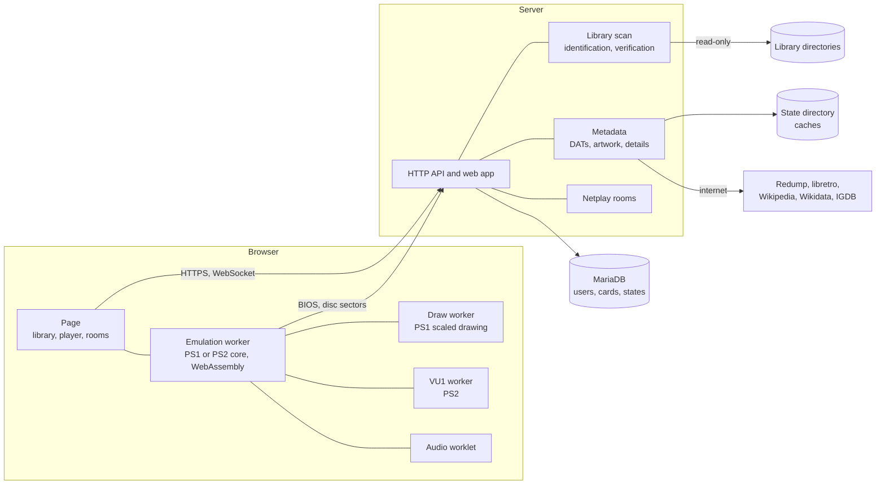

# Architecture

How Texel is put together: the server, the web app, and the two emulation cores, then the tools to work on them. [README.md](README.md) says what Texel is and how to run it; [DECISIONS.md](DECISIONS.md) records why things are the way they are (cited below as D1, D2…).

## Overview



The emulators run entirely in the browser: the server serves the web app, the BIOS images and the discs' sectors (on demand), keeps each user's memory cards and save states, and relays netplay rooms' input. It never runs a console.

## Repository

| Path | |
|---|---|
| `crates/ps1` | The PlayStation emulator: CPU (interpreted, and compiled to WebAssembly in browsers), GTE, GPU, CD-ROM, MDEC, SPU, controllers, memory cards |
| `crates/ps1-gpu` | The PlayStation's scaled drawing on the GPU (wgpu compute shaders), replaying what the software GPU records |
| `crates/ps2` | The PlayStation 2 emulator, in progress: the Emotion Engine (interpreted, and compiled to WebAssembly in browsers), the vector units (likewise), the VIFs, the GIF, the Graphics Synthesizer, the IPU, and the I/O processor (on `crates/ps1`'s CPU) with its devices |
| `crates/ps2-gpu` | The PlayStation 2's Graphics Synthesizer on the GPU (wgpu compute shaders), drawing what the software GS records |
| `crates/disc` | Disc layouts (CUE/BIN, ISO), raw sectors, ISO 9660, `SYSTEM.CNF`, SBI files |
| `crates/web`, `crates/web-ps2` | The WebAssembly bindings of each emulator: two modules, the PS2's loaded only for the PS2 |
| `crates/web-disc` | Disc images in the browser, for both modules: sectors fetched from the server on demand, through the worker |
| `crates/server` | The server |
| `frontend` | The web app (TypeScript, Vite), and Node.js scripts that check the cores' compilers |
| `deploy` | An example Kubernetes deployment |
| `docs` | Reference notes (the PlayStation's BIOS versions) |

## The server

`crates/server` (Rust, axum, sqlx) starts serving at once; the library scan, the DATs' download and the open-source BIOSes' come after, in the background, and the library is scanned again periodically and on an administrator's request (D52, D54).

- **Library** (`library.rs`): each console's BIOS and game directories, several of each, merged (D52). BIOS images are identified by their content wherever they are, zipped or not: the PS1's by their version string, the PS2's by their ROM's file system and `ROMVER`; the PS2's other firmware (DVD player, arcade boards' BIOSes, the MechaCon's) is listed apart and never booted (D62). Games are found as CUE/BIN, ISO, BIN, CHD, PBP or zips of these, and identified by the serial in their `SYSTEM.CNF` (through libretro's Redump-derived DAT) or by their track sizes; Redump's names group multi-disc games. A game's YAML file (next to it, or named after its serial anywhere in its directories, D8) points to its details when the automatic lookup fails. A loose BIN gets Redump's CUE sheet, and a LibCrypt-protected PS1 disc Redump's SBI file (D19, D53, D54).
- **Compressed images** (`images.rs`, `zipimage.rs`): CHD and PBP are decompressed by the server, which presents their tracks as BIN files (D11). Zipped images are read in the zip, without unpacking it: a deflated image is indexed once (a resume point every 4 MiB, kept in the state directory, about 1% of the image), then read from the nearest point (D51, D56).
- **Verification** (`verify.rs`): games are hashed in the background, track by track, against Redump's SHA-1s; hashes are kept in the database by path, size and modification time. Files read once in bulk (hashed, indexed) are dropped from the page cache as they are read (`pagecache.rs`).
- **Metadata** (`dat.rs`, `metadata.rs`, `infobox.rs`, `openbios.rs`): DATs, artwork and game details, cached in the state directory; the browser never contacts third parties (the server proxies the artwork). Artwork is looked for under Redump's name, then under the older names and other casings libretro-thumbnails keeps (D58).

  | Source | Used for |
  |---|---|
  | [Redump](https://redump.info/downloads) game DATs | Canonical names, regions, languages; SHA-1 verification |
  | [Redump](https://redump.info/downloads) BIOS DATs | BIOS and firmware models, verification |
  | [Redump](https://redump.info/downloads) SBI files | Subchannel data of LibCrypt-protected PS1 discs |
  | [Redump](https://redump.info/downloads) CUE sheets | BIN files found without their CUE sheet |
  | [libretro-database](https://github.com/libretro/libretro-database) | Serial → Redump name |
  | libretro-thumbnails ([PS1](https://github.com/libretro-thumbnails/Sony_-_PlayStation), [PS2](https://github.com/libretro-thumbnails/Sony_-_PlayStation_2)) | Box art, title screens, in-game snapshots |
  | [PCSX-Redux](https://github.com/pcsx-redux/pcsx-redux) builds | OpenBIOS, the open-source PS1 BIOS (from the newest build) |
  | [OpenPS2BIOS](https://github.com/TamaribaEmu/OpenPS2BIOS) releases | The open-source PS2 BIOS (the newest release) |
  | [Wikipedia](https://en.wikipedia.org/) | Game descriptions (CC BY-SA, credited on the game page) |
  | [Wikidata](https://www.wikidata.org/) | Genres, developers, publishers, game modes, release date |
  | [IGDB](https://www.igdb.com/) (optional) | Fills what Wikipedia and Wikidata lack; rating |

- **Accounts** (`auth/`): OpenID Connect (the server is the client: authorization code with PKCE) or invitations (Argon2id passwords); the browser holds a session cookie only. Requests that change something must come from Texel's own pages (`Sec-Fetch-Site`, `Origin`) (D44).
- **Database** (`db.rs`): MariaDB or MySQL: users and sessions, invitations, memory cards (each user's own, per console), save states (with their screenshots), each game's chosen BIOS and cards, and verification hashes. The server creates its tables (D9, D48).
- **Netplay** (`netplay.rs`): rooms of up to 8 people under a short code, over WebSocket: the server routes the controllers' input and the room's messages; it runs no emulation. Rooms live in its memory: one replica (D16, D46).
- **HTTP** (`api.rs`): the JSON API, BIOS and disc downloads (with ranges), and the web app, with the `Cross-Origin-Opener-Policy` and `Cross-Origin-Embedder-Policy` headers that `SharedArrayBuffer` needs (audio, the PS2's VU1 worker).

## The web app

`frontend` is a single-page app without a framework (`dom.ts`'s small `h()`): the library (`main.ts`), the BIOS page, memory cards (`cards.ts`), accounts and administration, rooms (`room.ts`, `netplay.ts`), and the player (`player.ts`).

The player runs a console in workers:

- **Emulation worker** (`worker.ts`): the PS1 or PS2 core (WebAssembly, D1, D26), paced by its audio (D3); the disc is read from the server sector by sector (`crates/web-disc`, D2). The cores compile their CPUs' code to WebAssembly modules as it runs (D30, D49).
- **Drawing**: where the browser has WebGPU, the cores' drawing runs on the GPU (`crates/ps1-gpu`, `crates/ps2-gpu`, D28, D29, D37, D39); the PS1's scaled drawing otherwise runs in software in a draw worker (`draw-worker.ts`), on another core (D40).
- **Audio**: samples go to an audio worklet (`audio-worklet.ts`) through a ring in a `SharedArrayBuffer`.
- **VU1 worker** (`vu1-worker.ts`, PS2): VU1 and VIF1 run beside the EE, fed through pipes in `SharedArrayBuffer`s, when the page is cross-origin isolated and the machine has four cores or more (D57).

Controllers come from the keyboard and the Gamepad API (`input.ts`, `gamepad.ts`), with a set-up for pads the browser does not know (`gamepad-ui.ts`). In a room, everyone runs the game in step: input is delayed by a few frames, measured from the round trips; every 120 frames the machines' checksums are compared, and a member who differs gets the state of the one with the controls (D16, D46).

## The PlayStation core

`crates/ps1` boots the BIOS shell and commercial games at full speed, with FMVs, CD audio, XA audio and reverb.

| Part | State |
|---|---|
| CPU (R3000A) | Interpreter with load/branch delay slots and exceptions, instruction cache, memory access times, multiply/divide and GTE stalls; compiled to WebAssembly in browsers |
| GTE | All commands, flags and the UNR divider, with command durations |
| GPU | Software rasteriser: polygons, rectangles, lines, textures (4/8/15-bit), semi-transparency, dithering, mask bit, VRAM transfers, 15/24-bit display; internal resolution 1× to 4×, on the GPU through WebGPU or in a draw worker, lowered while emulation lags; precise geometry (no wobbling polygons), perspective-correct textures, widescreen |
| CD-ROM | Commands, data reads, CD-DA playback with auto-pause and reports, XA-ADPCM streaming, the lid (disc changes), LibCrypt subchannel data (from SBI files) |
| MDEC | Decoding to 15/24-bit and monochrome output |
| SPU | 24 ADPCM voices, ADSR, volume sweeps, noise, pitch modulation, reverb, CD audio mixing, IRQ |
| Controllers | DualShock: digital and analog modes, configuration commands, rumble |
| Memory cards | Two slots; the cards are the server's (raw 128 KiB images) |
| Save states | The whole machine, its GPU's and SPU's timing included; exact (a state loaded runs on as the machine did) (D45) |
| Missing | Cycle-accurate timing (DMA and CD-ROM delays are approximate, GPU drawing time is modelled per pixel), SPU Gaussian interpolation, multitap, mouse, light guns, serial port 1, encrypted PBPs |

[docs/ps1-bios.md](docs/ps1-bios.md) describes the BIOS versions and which to use.

## The PlayStation 2 core

`crates/ps2` is in progress: it boots retail BIOSes to their browser, and a disc's game directly (fast boot: EELOAD starts the game's executable, D31). It runs in slices of 512 EE cycles, the IOP and the devices between them (D50). Of a library of 18 games, most reach their title screens or menus in their first minute (Jak and Daxter plays), some stop earlier.

| Part | State |
|---|---|
| Emotion Engine | MIPS R5900: interpreter with COP0 (exceptions, TLB), the FPU, the MMI SIMD instructions; compiled to WebAssembly in browsers, a block at a time (D30) |
| Vector units | VU0 (macro mode, as the EE's COP2, and microprograms) and VU1: interpreter with the flags' pipeline, microprograms compiled to WebAssembly (four lanes at once, in its SIMD) (D49). VU1's work is queued until the EE side needs it, and can run in its own worker (D57) |
| VIF0, VIF1 | UNPACK (all formats, masks, modes), MPG, MSCAL/MSCNT, DIRECT, double buffering |
| GIF | Paths 1 to 3: PACKED, REGLIST and IMAGE |
| Graphics Synthesizer | Software rasteriser (sprites, triangles, lines, textures in every format, CLUTs, blending, depth and alpha tests, fog), transfers both ways, privileged registers; on the GPU through WebGPU: the software GS records what it is asked, `crates/ps2-gpu` draws it (D25, D28, D29) |
| IPU | MPEG-1/2 decoding (BDEC, IDEC, VDEC, FDEC), colour conversion (CSC, PACK), its DMA channels: movies play (D60) |
| DMA, INTC, timers | The EE's channels (normal, chain, interleave), interrupt controller (a vertical blank's interrupt waits for the next read of INTC_STAT, D59), four timers |
| I/O processor | `crates/ps1`'s CPU, with its own memory map, interrupts, six timers and DMA; the SIF between it and the EE (D24) |
| CDVD | N commands (reads of CD and DVD sectors, the end once DMA has the data, D61), S commands (clock, region, EEPROM), disc changes |
| SPU2 | Two cores of 24 voices (the PS1's SPU's), sound memory, DMA, reverb (D33) |
| SIO2 | Controllers (DualShock) and memory cards (8 MiB, with ECC; formatted by the server) (D32) |
| Save states | The whole machine, GS memory included (read back from the GPU) (D34) |
| Missing | The DualShock 2's pressure-sensitive buttons (some games refuse to start without), the IOP's reboot into a game's DNAS image (Jak X), the DVD player, arcade boards, cycle-accurate timing, speed: Jak's jungle runs at about 16 frames per second (of 50) |

Determinism matters throughout: save states, netplay and the compilers' checks (a compiled and an interpreted machine must reach the same state) need a run to go the same way each time. VU1's worker syncs at points that depend on the EE's side only, so a machine with the worker and one without go the same way (D57).

## Development

`nix develop` gives the toolchain: Rust (with the wasm32 target), wasm-bindgen, binaryen, Node.js, pnpm, chdman, and (on Linux) the Vulkan loader. CI runs `cargo fmt --check`, `cargo clippy -D warnings` (natively and for wasm32), `cargo test`, `yamllint --strict`, the web app's build and type check, and a smoke test of the container image.

Running the server and the web app locally is described in the README (Building from source). With the server on port 8080, `pnpm dev` (in `frontend`) serves the web app with Vite, proxying `/api`.

### The PlayStation without a browser

```sh
cargo run --release -p texel-ps1 --example headless -- BIOS [DISC.cue] [FRAMES] [OUT_DIR]
PRESS="1900:cross,2300:start" cargo run --release -p texel-ps1 --example headless -- …
```

It writes a PPM screenshot every 60 frames and prints the machine state. More environment variables: `SCALE=2` (internal resolution), `SWAP=1900:1960` (open the lid at a frame, close it again at another), `STATE=3000:3300` (save a state at a frame, load it at another: checks that states are exact), `CDLOG=1` (the CD-ROM's commands and the XA sectors played, with the SPU's volumes).

The scaled drawing on the GPU is checked against the software, which it must match pixel for pixel: `cargo run --release -p texel-ps1-gpu --example compare -- BIOS DISC.cue [FRAMES] [SCALE] [OUT_DIR]` runs a game twice in step and compares the displayed pictures every second (`GPU_ONLY=1`: the GPU alone, to measure it; `PRESS` as above). The CPU's compiler is checked in WebAssembly: `node scripts/check-ps1-compiler.mjs BIOS DISC.cue [SECONDS]` (in `frontend`, after `pnpm run wasm`) runs a game compiled and interpreted, and fails unless both machines are in the same state every second.

### The PlayStation 2 without a browser

```sh
cargo run --release -p texel-ps2 --example boot -- PS2-BIOS [SECONDS]
```

It prints what the BIOS kernel writes to its debug port (its start-up log) and what the IOP's modules print (their `printf`, which retail consoles send nowhere), then where the CPUs are, what they wait for, the traffic between them, and what they used that is not emulated. Environment variables:

| Variable | |
|---|---|
| `DISC=image.iso` (or a raw `.bin`) | Puts a disc in the drive and boots its game directly (`OSD=1`: through the browser instead) |
| `MC1=card.ps2`, `MC2=…` | Memory cards (created unformatted if missing, saved at the end) |
| `LOAD=state`, `SAVE=state` | Start from a save state; save one at the end |
| `PRESS="16:cross,20.5:start"` | Hold buttons for 0.2 s from a time (seconds of console time) |
| `SHOTS=dir` | The displayed frame every second (PPM) |
| `NOGFX=1` | Draw nothing (faster) |
| `VU1THREAD=1` | VU1 in a thread of its own |
| `WAV=out.wav` | The sound |
| `DUMP=1` | The busy loops' instructions and the EE's registers |
| `EXC=1`, `EEREGS=1`, `IOPREGS=1`, `TLB=1` | The EE's last exceptions and system calls; registers; the TLB |
| `PACKETS=1`, `TAGS=1` | The SIF's commands and DMA tags |
| `CODE=start,end`, `FIND=imm`, `IOPFIND=imm` | EE memory (hex); EE or IOP loads and stores with that offset |
| `CDVDCMDS=1`, `CARDLOG=1`, `SIO2TRACE=1` | The drive's commands; the cards'; SIO2's registers |
| `DRAWS=frames` | What the GS was asked to draw over that many more frames |
| `PROG=hex`, `FINDXY=x,y` | VU1's runs from there; which GIF path sent a vertex |

The GS on the GPU (`crates/ps2-gpu`, with wgpu: Vulkan, Metal or DirectX 12 natively, WebGPU in browsers) is checked against the software GS: `cargo run --release -p texel-ps2-gpu --example compare -- PS2-BIOS [SECONDS] [OUT_DIR]` boots a BIOS with both and prints, every second, how many GS memory words differ (`PAGES=1`: by page), writing both displayed frames (`GPU_ONLY=1`: the GPU alone, to measure it; it takes `DISC`, `MC1` and `PRESS` too). Its tests (`cargo test -p texel-ps2-gpu`) draw with both and compare the whole GS memory; without a GPU, they pass and say so.

The compilers and VU1's worker are checked in WebAssembly with Node.js (in `frontend`, after `pnpm run wasm`), each failing unless both machines reach the same state every second:

```sh
node scripts/check-ps2-compiler.mjs PS2-BIOS [SECONDS] [DISC.iso STATE]   # the EE's code compiled and interpreted
node scripts/check-ps2-vu.mjs PS2-BIOS DISC.iso STATE [SECONDS]          # the VUs' microprograms compiled and interpreted
node scripts/check-ps2-vu1-worker.mjs PS2-BIOS SECONDS DISC.iso STATE      # VU1 inline and in a worker
```

### Tests on real files

Some tests need files that cannot be in the repository; they are ignored unless asked for: `TEXEL_ZIP=game.zip TEXEL_ZIP_IMAGE=game.iso cargo test -p texel-server -- --ignored real_zip` checks the zip reader against the image itself.
